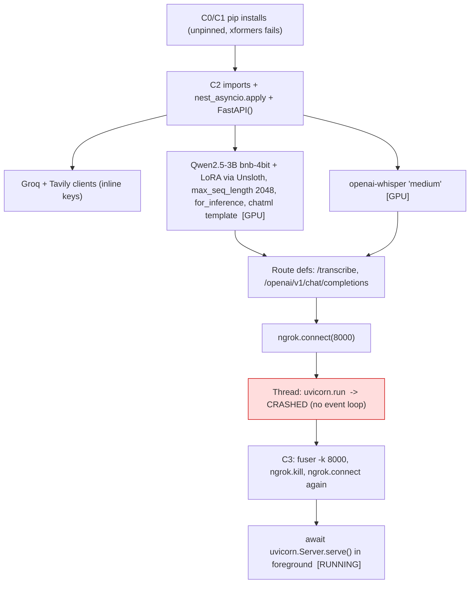
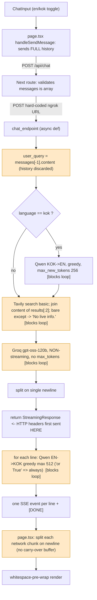
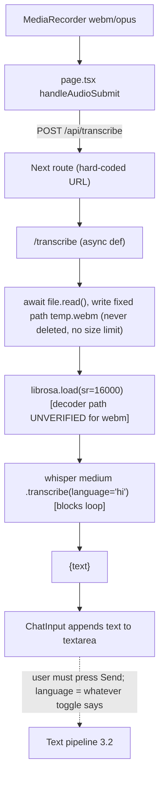
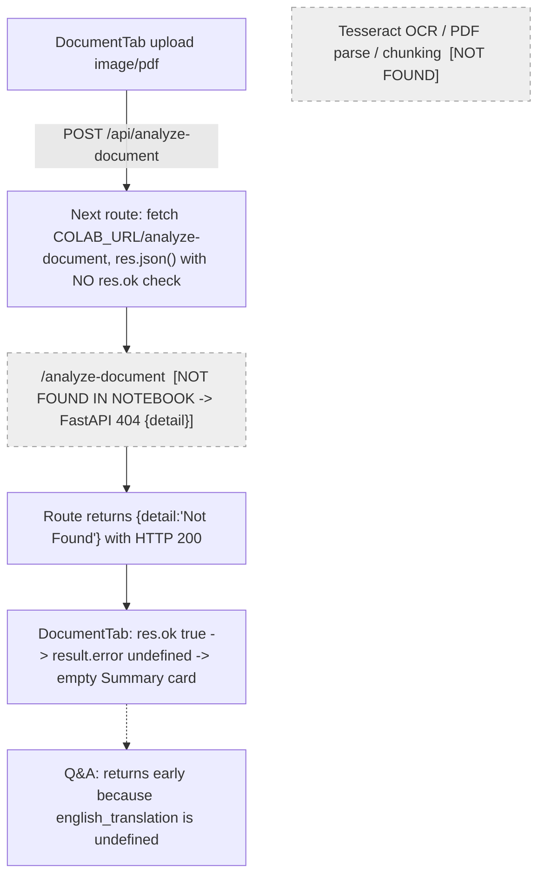

# Konkani Companion — Read-Only Technical Audit

- **Date:** 2026-10-10
- **Repo state audited:** branch `main` @ `3950f4c` (clean), plus untracked `backend_colab.ipynb` and `Konkani_Companion_Project_Architecture.pdf`
- **Scope:** static, read-only analysis. No code was executed, nothing was installed, no network calls were made.
- **Secrets:** none of the three notebook keys or the `.env.local` values are reproduced here.
- **Notebook cell numbering:** C0–C3 (zero-indexed code cells of `backend_colab.ipynb`).

> **Decision recorded 2026-10-10 (from the project team):** output is **always Konkani**. The en/kok toggle selects the **input** language only:
> - **English mode:** English input → reasoning in English → Konkani output.
> - **Konkani mode:** Konkani input → translated to English → reasoning in English → Konkani output.
>
> So `or True` in `stream_generator` is **intended behaviour, not a bug**. F-02 has been downgraded to LOW, and the related sections below are updated.

---

## 1. Executive summary

**What the project does today.** It's a Next.js 16 chat app (`src/app/page.tsx`) that sends requests through its own API routes to a FastAPI server. That server runs in a Colab notebook on a T4 GPU and is exposed through ngrok. For each chat message the backend:
1. Translates the input from Konkani to English with a 4-bit Qwen2.5-3B LoRA, but only when the toggle is set to Konkani.
2. Runs one Tavily search and keeps the first 2 snippets.
3. Calls Groq once, without streaming, using **`openai/gpt-oss-120b`**.
4. Splits the English answer on single newlines and translates **each line** into Konkani with Qwen, whatever language was selected. This is intentional: output is always Konkani.
5. Sends one SSE event per translated line.

Voice input goes to Whisper **medium** with `language="hi"`. The transcript is put into the text box, and the user still has to press Send.

**What works, based on the code and the saved notebook output.**
- Model loading works: the logs show the adapter `braisefernz07/konkani-qwen-lora` loading on top of `unsloth/Qwen2.5-3B-Instruct-unsloth-bnb-4bit`.
- The foreground server in cell C3 started and answered one English chat request with HTTP 200. That request made one Groq call, then 3 Qwen translation passes.
- The proxy from the Next.js routes to the backend and the client-side SSE rendering are wired up.
- Only that one English request appears in the logs. A Konkani-mode request and `/transcribe` never appear in the saved outputs.

**Biggest gaps between the code and the presentation:**
- The reasoning model is gpt-oss-120b, not Llama 3.3 70B.
- Whisper is medium, not Large V3, and there is no phonetic adapter.
- **No Tesseract, OCR or document endpoint exists in the backend.** The Document Lens tab calls `/analyze-document` and `/document-chat`, which don't exist in the notebook.
- There is **no 250-word chunking**. Text is split on `\n`.
- Output is **not streamed token by token**. Nothing reaches the browser until the whole Groq answer is finished and the first line has been translated.
- There is no agentic orchestration: it's a fixed linear pipeline with one search per request.
- Search results are passed without URLs or titles, so citations aren't possible.

**Most important issues:**
1. Live Groq, Tavily and ngrok credentials are hard-coded in the notebook. The file is untracked in git but **not ignored**.
2. Document Lens has no backend and fails silently.
3. The streaming and latency claim is not what the code does.
4. Every blocking model and API call runs inside `async` endpoints, so the server effectively handles one request at a time.
5. The frontend SSE parser can drop whole paragraphs when an event is split across network chunks.

(Always-Konkani output via `or True` was first listed here as an issue. The team has confirmed it is intended; see the decision note at the top.)

---

## 2. Repository map

| Path | Role | Notes |
|---|---|---|
| `backend_colab.ipynb` | **The only backend.** 4 code cells, C0–C3 | Untracked in git (`??`), not ignored |
| C0 | `pip install` of Unsloth (from git HEAD), xformers, `trl<0.9.0`, peft, accelerate, bitsandbytes | The xformers install **failed** ("No matching distribution") |
| C1 | `pip install` of fastapi, `uvicorn==0.29.0`, nest-asyncio, pyngrok, tavily-python, groq, openai-whisper, librosa | Only uvicorn is pinned |
| C2 | Imports, inline keys, Qwen and Whisper loading, `ChatPayload`, `/transcribe`, `/openai/v1/chat/completions`, ngrok, **server started in a background thread** | That thread **crashed**: `RuntimeError: There is no current event loop` (uvloop + nest_asyncio) |
| C3 | `fuser -k 8000/tcp`, ngrok kill and reconnect, foreground `await server.serve()` | **This is the server that actually runs.** `execution_count=None` means it was still running when the notebook was saved |
| `Konkani_Companion_Project_Architecture.pdf` | 10-slide design and claims deck | Untracked. All 10 pages read as images |
| `src/app/page.tsx` | Chat state, send/stream loop, audio submit, localStorage sessions | |
| `src/components/ChatInput.tsx` | Text box, en/kok toggle, MediaRecorder (webm) | The paperclip button has no handler |
| `src/components/KonkaniKeyboard.tsx` | On-screen Devanagari keyboard | Works as described in the deck |
| `src/components/DocumentTab.tsx` | Document Lens UI: upload → analyze → Q&A | Expects `{ocr_text, english_translation, summary, error}` |
| `src/components/ChatMessages.tsx`, `Sidebar.tsx`, `Header.tsx` | Display | |
| `src/app/api/chat/route.ts` | Proxy to `/openai/v1/chat/completions` | **Hard-coded** ngrok URL (line 21) |
| `src/app/api/transcribe/route.ts` | Proxy to `/transcribe` | **Hard-coded** ngrok URL (line 20) |
| `src/app/api/analyze-document/route.ts`, `document-chat/route.ts` | Proxies to endpoints that **don't exist** | Use the `NEXT_PUBLIC_COLAB_URL` env var |
| `src/app/api/save-chat/route.ts` | Writes chat to Firestore `chats/{sessionId}` with the client SDK | |
| `src/app/api/models/route.ts` | Lists Groq models | **Dead code**: nothing calls it |
| `src/lib/db.ts` | Firestore helpers for the `sessions` collection | **Dead code**: never imported |
| `src/app/layout.tsx` | Loads the legacy Google Input Tools script; title is "AI Chat \| Premium Multi-Model Assistant" | Leftover from the template |
| `.env.local` (gitignored) | `GROQ_API_KEY`, Firebase web config, `NEXT_PUBLIC_COLAB_URL` | Only variable names were inspected |
| Tests, benchmarks, training code | **None found** | |

**Git history:** in the initial commit (`11af105`), `/api/transcribe` called **Groq `whisper-large-v3-turbo` with `language: "en"`** directly from Next.js. Commit `98db5cc` moved transcription to Colab. That earlier version is the likely origin of the deck's "Whisper Large V3" claim. Commit `59caed3` added Document Lens on the frontend only.

**What limits these conclusions:**
- The LoRA training notebook and dataset aren't in the repo.
- The Hugging Face adapter's contents weren't visible beyond the identifiers in the logs.
- The Firestore security rules weren't available.
- The logs contain no Konkani-mode or `/transcribe` run.
- There may be another notebook version with document endpoints.

---

## 3. Architecture walkthrough

### 3.1 Initialization (runs once, notebook C2 then C3)

- **On the local GPU** (T4, 14.56 GB): Qwen 4-bit is about 2–2.5 GB by estimate, and Whisper medium is about 1.5–3 GB by estimate. Neither number was measured. bf16 is disabled on the T4.
- **Remote services:** Groq (reasoning), Tavily (search), Hugging Face (model download at startup), ngrok (ingress).
- **Work done on every request:** tokenization, `model.generate`, the Tavily call, the Groq call and `whisper.transcribe`. Nothing is cached between requests.
- **Versions seen in the saved output:** Unsloth 2026.10.3, Transformers 5.17.0, Torch 2.11.0+cu130, Python 3.13, Tesla T4.

### 3.2 Text query (what actually happens)

What each stage does:

| Stage | Input | Model or service | Output |
|---|---|---|---|
| Next route | `{messages, language, stream}` | — | Forwards it. `model` isn't sent |
| Backend | `ChatPayload` (`messages: list` is **untyped**; `model` and `stream` are ignored) | — | — |
| Pre-translation | Last message's content | Qwen + system prompt "Translate the following Devanagari Konkani text into English." | English string, at most 256 new tokens |
| Search | English query (or raw Devanagari in en mode) | Tavily `search_depth="basic"`, default result count | Two snippets joined by `\n`. Title and URL are dropped |
| Reasoning | System prompt (snippets put *inside the system prompt*) plus the query | Groq `openai/gpt-oss-120b` | Full answer string |
| Post-translation | Each non-empty line | Qwen, system prompt "Translate the following English text into Devanagari Konkani." | Up to 512 new tokens per line |
| Streaming | — | — | `data: {"choices":[{"delta":{"content": line + "\n\n"}}]}` |

Exceptions from Qwen or Groq before `return` produce FastAPI's default 500, and the frontend shows a generic error. An exception *inside* the generator happens after the 200 was already sent, so the stream just stops. The frontend never checks for `[DONE]`, so a truncated answer looks complete and gets saved.

**Loading indicator gap.** The assistant bubble and blinking cursor are only created when `fetch` resolves, which happens after Groq finishes. During the longest wait, the last visible message is the user's, and `ChatMessages` only shows the cursor on an assistant message. So **the UI shows no loading indicator during the main wait**.

### 3.3 Speech to text

`/transcribe` does **not** start the answer pipeline; the frontend handles that handoff. If the toggle is on English, a Devanagari transcript is sent with `language=en`. It then skips pre-translation and goes straight to Tavily and Groq as Devanagari.

### 3.4 Documents

---

## 4. Component inventory

| # | Component | Intended | Actual | Evidence | Status | Limitations |
|---|---|---|---|---|---|---|
| 1 | Qwen 2.5 3B + LoRA | KOK↔EN translation bridge | `braisefernz07/konkani-qwen-lora` on `unsloth/Qwen2.5-3B-Instruct-unsloth-bnb-4bit` | C2 `from_pretrained`; HF log lines in C2 output | IMPLEMENTED | Training data, prompt format and regularization not in repo |
| 2 | 4-bit + Unsloth inference | Efficient inference | `load_in_4bit=True`, `for_inference` | C2 output banner | IMPLEMENTED | Versions unpinned; xformers absent |
| 3 | KOK→EN | Pre-translation | Only when `language=="kok"`; greedy; max 256 tokens | `chat_endpoint` | PARTIALLY IMPLEMENTED | No chunking; depends on the UI toggle, not the script of the input; never shown running in logs |
| 4 | EN→KOK | Post-translation (always, by design) | Per `\n` line, always | `stream_generator`, `or True` | IMPLEMENTED | Intended; the `or True` form hides the intent |
| 5 | Whisper | Large V3 | `whisper.load_model("medium")`, `language="hi"` | C2 | PARTIALLY IMPLEMENTED | Wrong model size; Hindi decoding |
| 6 | Phonetic adapter | Corrects Konkani phonemes | Nothing | Whole repo | NOT FOUND IN INSPECTED FILES | — |
| 7 | Groq reasoning | Llama 3.3 70B | `openai/gpt-oss-120b`, non-streaming | `groq_client.chat.completions.create` | IMPLEMENTED (different model) | No timeout, max_tokens or error handling |
| 8 | Tavily | Live retrieval | One basic search per request | C2 | IMPLEMENTED | Runs even for "hello" |
| 9 | Context + attribution | Citation-aware RAG | `results[:2]['content']` only | C2 | PARTIALLY IMPLEMENTED | No URLs or titles; no citations |
| 10 | Tesseract / PDF | Document ingestion | Frontend UI and proxies only | DocumentTab, analyze-document route | NOT FOUND IN INSPECTED FILES (backend) | Frontend fails silently |
| 11 | 250-word chunking | Long translations | Splits on `\n` | `english_answer.split('\n')` | NOT FOUND IN INSPECTED FILES | — |
| 12 | FastAPI + validation | Typed API | Pydantic model with untyped `list` | `ChatPayload` | PARTIALLY IMPLEMENTED | No role, content or size checks |
| 13 | SSE streaming | Token-by-token | Per-line events after full Groq answer | `StreamingResponse` | PARTIALLY IMPLEMENTED | Frontend parser has no line buffer |
| 14 | Temp audio / concurrency | Safe concurrent uploads | Fixed `temp.webm`, never deleted | `/transcribe` | PARTIALLY IMPLEMENTED | Safe now only because the event loop is blocked |
| 15 | GPU / memory mgmt | Fit in consumer GPU | Two models resident; no lock, batching or cache cleanup | C2 | UNVERIFIED | Peak VRAM never measured |
| 16 | ngrok / lifecycle | Stable ingress | Two startup blocks; C2 thread crashed; C3 works | C2/C3 outputs | PARTIALLY IMPLEMENTED | Uses `fuser -k` |
| 17 | Dependencies | Reproducible | Unpinned (git HEAD Unsloth) | C0/C1 | PARTIALLY IMPLEMENTED | Will drift as Colab images change |
| 18 | Credentials / config | Secure | Inline keys in notebook; URL hard-coded in 2 routes, env var in 2 others | C2; routes | PARTIALLY IMPLEMENTED (insecure) | — |
| 19 | Logging / errors | Observability | `print` statements; bare `except` | C2 | PARTIALLY IMPLEMENTED | No timings or request IDs |
| 20 | Tests / perf | Measured claims | None | Repo | NOT FOUND IN INSPECTED FILES | — |

Additional components: on-screen Konkani keyboard is **IMPLEMENTED**. Chat persistence uses localStorage plus write-only Firestore, so it's **PARTIALLY IMPLEMENTED**.

---

## 5. PDF-versus-code discrepancy matrix

| Presentation claim | PDF evidence | Code evidence | Status | Technical implication |
|---|---|---|---|---|
| Qwen 2.5 3B, 4-bit, LoRA via Unsloth | Slides 5, 6, 10 | C2 load logs | **MATCH** | Translation quality still unmeasured |
| Trained on parallel corpora with "heavy regularization" | Slide 5 | No training code | **NOT VERIFIED** | Need the training notebook and data card |
| Bidirectional translation | Slide 10 | Both prompts present | **PARTIAL** | Only EN→KOK appears in logs; KOK→EN depends on the toggle |
| Whisper Large V3 | Slides 1, 5, 7, 9 | `load_model("medium")` | **MISMATCH** | Different accuracy and latency; earlier git version used Groq large-v3-turbo |
| Custom phonetic adapter / fine-tuned for Konkani | Slides 5, 10 | None; `language="hi"` | **MISMATCH** | Hindi decoding prior is the "phonetic bleed" the deck criticises (slide 3) |
| Llama 3.3 70B on Groq | Slides 1, 6, 7, 9, 10 | `openai/gpt-oss-120b` | **MISMATCH** | Different model family; reasoning model adds hidden thinking-token latency; formatting behaviour differs |
| Tavily live retrieval | Slides 6, 7 | Yes, one call | **MATCH** (basic) | — |
| Citation-aware, "grounding every response in verifiable data" | Slides 6, 7 | No URLs in prompt; no citation instruction | **MISMATCH** | Answers can't be traced to sources |
| Bidirectional Llama↔Tavily "RAG core" | Slide 7 | One-shot search before the LLM | **MISMATCH** | No iterative retrieval |
| Agentic Orchestration Layer | Slide 5, title | Fixed linear pipeline | **MISMATCH** | No routing, tool choice or planning |
| 250-word chunking | Slides 6, 9, 10 | `split('\n')` | **MISMATCH** | Truncation risk on long lines |
| Token-by-token streaming, low TTFT | Slides 6, 9 | Per-line SSE after full Groq answer | **MISMATCH** | First output waits for search + full LLM + one translation |
| Tesseract OCR / PDF ingestion | Slides 5, 6, 7, 9 | Not in backend | **MISMATCH** | Demo Test 2 can't succeed with this notebook |
| Document Lens UI | Slides 8, 10 | DocumentTab exists | **PARTIAL** | Frontend only |
| Custom keyboard | Slide 10 | KonkaniKeyboard.tsx | **MATCH** | — |
| Multimodal ingestion normalized to text | Slide 6 | Voice → textarea (manual send); documents missing | **PARTIAL** | — |
| Decoupled, swappable modules | Slide 7 | All logic in one notebook cell | **PARTIAL** | Services are separate, but code isn't modular |
| Edge-deployable / consumer-GPU envelope | Slides 2, 4 | Colab T4 + two cloud APIs + ngrok | **NOT VERIFIED** | Quantized local model ≠ edge deployment; requires internet |
| "5+ s" latency of traditional pipelines | Slide 3 | No measurements | **NOT VERIFIED** | This pipeline is itself an ASR→translation→LLM→translation chain |

---

## 6. Detailed findings

### F-01 — Live API credentials are hard-coded in the backend notebook
- **Severity:** HIGH. It becomes CRITICAL if the notebook has been shared publicly or committed anywhere.
- **Confidence:** Confirmed from code.
- **Location:** `backend_colab.ipynb` C2: the `Groq(api_key=…)` and `TavilyClient(api_key=…)` calls and `ngrok.set_auth_token(…)`.
- **Evidence:** Three string literals. `git status` shows the file as `??`, untracked and not covered by `.gitignore`.
- **Impact:** Anyone with the notebook can use your Groq and Tavily quota and open tunnels on your ngrok account. A single `git add .` would commit all three.
- **Root cause:** Colab convenience; no secrets mechanism used.
- **Direction:** Rotate all three keys now. Load them from Colab Secrets (`google.colab.userdata`) or environment variables. Add `*.ipynb` handling, or strip secrets before saving the notebook.
- **Trade-offs:** None of note; one extra setup step per teammate.
- **Validation:** Scan the repo and notebook for key patterns; old keys return 401.

### F-02 — Input-language routing relies only on the toggle (always-Konkani output is intended)
- **Severity:** LOW. It was HIGH before the team confirmed the intended behaviour.
- **Confidence:** Confirmed.
- **Location:** C2 `chat_endpoint` (`if current_lang == "kok"`) and `stream_generator` (`if current_lang == "kok" or True: # Capstone default`).
- **Intended behaviour (confirmed by the team):**
  - The toggle selects the **input** language only.
  - KOK→EN pre-translation runs only in Konkani mode.
  - EN→KOK post-translation always runs.
  - The code does exactly this. The saved log shows a `USER (en)` request followed by three EN→KOK passes, which is correct.
- **Residual issues:**
  1. **Wrong toggle position.** If the input is Devanagari while the toggle is on English, pre-translation is skipped. Tavily and Groq then receive raw Konkani. Groq may answer in Hindi or Konkani instead of English, and Qwen is then asked to translate non-English text "from English". The most likely way to hit this is voice input, because the transcript lands in the text box no matter which toggle is selected (F-09). The opposite case can happen too: Latin-script text typed in Konkani mode gets "translated" from Konkani.
  2. **Readability.** `current_lang == "kok" or True` reads like a leftover bug, and the payload field is called `language` when it really means the input language.
- **Direction:**
  - Decide pre-translation from the script of the input, using the toggle only as a hint. For example, translate when most letters are Devanagari.
  - Write the always-Konkani rule as an explicit unconditional step or a named constant, not `or True`.
  - Optionally, have the UI switch the toggle to Konkani automatically when a voice transcript arrives.
- **Trade-offs:** Script detection doesn't recognise romanized Konkani; that would still need the toggle.
- **Validation:** Contract tests for the four combinations, {en, kok} toggle × {Latin, Devanagari} input. All four should produce an English internal query and Konkani output.

### F-03 — Document Lens calls backend endpoints that don't exist and fails silently
- **Severity:** HIGH, because it's the PDF's demo Test 2. **Confidence:** Confirmed for the inspected notebook.
- **Location:** `src/app/api/analyze-document/route.ts:8-14`, `src/app/api/document-chat/route.ts`, `src/components/DocumentTab.tsx:81-87`.
- **Evidence:** No `/analyze-document` or `/document-chat` routes, and no tesseract, pdf or OCR imports, in the notebook.
- **What happens:** FastAPI returns 404 `{"detail":"Not Found"}`. The route calls `res.json()` without checking `res.ok` and returns that body **with status 200**. DocumentTab sees `res.ok`, so `result.error` is undefined and an empty "Document Summary" card renders. Q&A returns early because `english_translation` is undefined. If `NEXT_PUBLIC_COLAB_URL` is empty, `fetch("/analyze-document")` throws on the server and Next returns a 500.
- **Root cause:** The frontend was built against a backend contract that was never implemented, or was implemented in a notebook not provided for this audit.
- **Direction:** Either implement the endpoints (OCR → KOK→EN → summary → EN→KOK, matching the existing response shape) or mark the feature as not available. Either way, propagate upstream status in both routes.
- **Validation:** Upload fixtures (printed Devanagari image, text PDF, scanned PDF, non-document) and check the response schema and status codes.

### F-04 — "Token-by-token streaming / low TTFT" is not what happens
- **Severity:** HIGH (headline-claim and UX). **Confidence:** Confirmed from code; actual numbers need measurement.
- **Location:** C2 `chat_endpoint`; the Groq call has no `stream=True`.
- **Time to first event, from the code:** [Qwen KOK→EN if kok] + Tavily round trip + **full** gpt-oss-120b generation (including hidden reasoning) + Qwen translation of line 1. After that, each further line costs one more sequential `generate`.
- **Event granularity:** One complete translated line per event. Qwen output isn't streamed either (no `TextIteratorStreamer`).
- **UI effect:** No loading indicator during the longest phase (Section 3.2).
- **Root cause:** Translation needs complete English units, and the Groq answer is only taken as a whole.
- **Direction:** Stream Groq tokens and buffer them until a sentence or paragraph boundary. Hand each completed unit to Qwen while Groq continues generating, so the two run in parallel. Optionally stream Qwen tokens too. Send an immediate "thinking" event or status so the first byte arrives quickly.
- **Trade-offs:** Translating smaller units loses context across sentences; this needs a quality check. Adds complexity.
- **Validation:** Instrument time to first event, time to first Konkani text, total time and gap between events (Section 8).

### F-05 — Documented reasoning model ≠ configured model
- **Severity:** MEDIUM. **Confidence:** Confirmed.
- **Evidence:** `model="openai/gpt-oss-120b"`. The deck says Llama 3.3 70B; the dead `src/app/api/models/route.ts` still lists `llama-3.3-70b-versatile`.
- **Impact:** Report claims and demos describe a different system. gpt-oss is a reasoning model: hidden thinking tokens add to time to first token. Markdown output (tables, bullets, headings) despite "Pure text only" is a hypothesis to test. Combined with `split('\n')`, each table row would be translated separately. If generation is cut off during reasoning, `content` could be `None`, and `.strip()` would raise. That last point is plausible but needs validation.
- **Direction:** Pick one model, put it in config, and update the deck or the code to match. Set `max_tokens`, a timeout and reasoning effort explicitly.

### F-06 — Blocking work in `async def` endpoints serializes the whole server
- **Severity:** MEDIUM. **Confidence:** Confirmed from code; impact needs measurement.
- **Location:** `/transcribe` (`librosa.load`, `stt_model.transcribe`); `chat_endpoint` (`model.generate`, Tavily, Groq); `stream_generator` (`model.generate` between yields).
- **Impact:**
  - While one request is inside a blocking call, the event loop can't do anything else. Other users' streams freeze and `/transcribe` waits.
  - Starlette can't notice a client disconnect until the next yield, so GPU work continues for users who have left.
  - This blocking is also what accidentally prevents concurrent GPU access and `temp.webm` collisions. Moving work to threads **without** adding a GPU lock and unique temp files would introduce those bugs.
- **Direction:** Use async clients for Groq and Tavily. Run GPU work in a worker thread behind a single GPU lock or queue. Use per-request temp files. Check for disconnects between translation units.
- **Validation:** Two concurrent chats plus one transcription; measure each one's time to first event and peak VRAM.

### F-07 — Translation length handling: hard caps, no chunking, newline splitting
- **Severity:** MEDIUM. **Confidence:** Strongly indicated; truncation frequency needs measurement.
- **Evidence:**
  - Pre-translation has `max_new_tokens=256`. Long Konkani questions get their English silently truncated before search and reasoning.
  - Post-translation has 512 per line. Devanagari typically costs several Qwen tokens per word (a hypothesis; measure with the tokenizer alone), so a long line can be cut off mid-sentence.
  - Splitting on single `\n` fragments lists and tables and removes blank-line structure. Every line is then re-joined with `"\n\n"`.
  - There's no end-of-sequence check, and no `attention_mask` is passed. That's fine for one unpadded sequence but would break if batching were added.
- **Model-specific risk:** The tokenizer is re-templated with Unsloth `"chatml"`. Whether that matches the training template and system prompts exactly is **unverified** and directly affects quality.
- **Direction:**
  - Use word- or token-budgeted chunking that respects sentence boundaries (the deck's 250 words, sized from measured token ratios).
  - Detect truncation (output reached `max_new_tokens` without EOS) and retry with smaller units.
  - Keep formatting outside the translated text: translate list or table cell text, not the markup.
  - Batch the units of one answer in a single `generate` call.
- **Validation:** Length sweep (10–600 words), truncation rate, chrF++ against references.

### F-08 — Retrieval is "search + paste two snippets", not grounded RAG
- **Severity:** MEDIUM. **Confidence:** Confirmed.
- **Evidence:**
  - `tavily_client.search(query=internal_query, search_depth="basic")`, then `"\n".join(r['content'] for r in results[:2])`.
  - Titles, URLs and scores are dropped.
  - A bare `except:` replaces any failure with the literal text "No live info.", which is then placed in `<live_context>`.
  - Search runs for every message, including greetings.
  - Snippets go **into the system prompt**, so untrusted web text gets system-level priority. That's a prompt-injection surface.
  - No instruction to answer only from the context, to cite sources or to say when evidence is missing.
- **Impact:** Answers can't be checked; failures are invisible; added latency; the model can mix retrieved facts with its own knowledge without any marker.
- **Direction:**
  - Pass numbered sources (title, URL, snippet) as clearly delimited **user-side** data, not system instructions.
  - Instruct the model to cite `[n]` and to say when information is missing, and keep the URLs through translation (don't translate the URLs).
  - Log search failures separately from empty results.
  - Make the decision to search explicit, with a simple heuristic or a tool call. That would also give the "agentic" claim some substance.
- **Validation:** Section 8 retrieval set; citation precision (does the cited source support the sentence).

### F-09 — Speech pipeline: model, language, decoding and file handling
- **Severity:** MEDIUM. **Confidence:** Confirmed from code; decoding reliability needs validation.
- **Evidence:**
  - Whisper `medium`, `language="hi"`, no adapter.
  - Webm/opus is decoded with `librosa.load`. libsndfile may not read webm, and librosa's audioread fallback is deprecated; Whisper could instead take the file path and decode with ffmpeg.
  - Fixed `temp.webm` is overwritten and never deleted, so the last user's audio stays on disk.
  - `await file.read()` reads the whole upload into memory with no size or duration limit. Long audio holds up the entire server (F-06).
  - No content-type validation. `librosa` exceptions become 500s.
  - The saved output also shows the Whisper cache failing its checksum and being re-downloaded at load time.
- **Impact:** Konkani is decoded with a Hindi prior. The transcript is inserted regardless of the toggle, so in en mode Devanagari skips pre-translation (F-02).
- **Direction:**
  - Evaluate medium vs large-v3 vs large-v3-turbo with `hi` vs `mr` vs no language setting, by character error rate on Konkani audio, before claiming an adapter.
  - Add per-request temp files with cleanup, size and duration limits, and a type check.
- **Validation:** WER and CER on a held-out Konkani set; malformed and oversized upload tests.

### F-10 — Frontend SSE parser drops events that are split across network chunks
- **Severity:** MEDIUM. **Confidence:** The defect is confirmed in code; how often it happens needs validation.
- **Location:** `src/app/page.tsx:98-120` and `src/components/DocumentTab.tsx:132-149`.
- **Evidence:** Each `reader.read()` chunk is split on `\n` with no buffer carried to the next chunk. A `data: {...}` line split across two reads fails `JSON.parse`, and that line is logged and **dropped**. `json.dumps` escapes Devanagari to `\uXXXX`, about 6 bytes per character, so events are large. ngrok and the Next proxy can split them. A dropped event loses a whole paragraph of the answer.
- **Related, also confirmed:**
  - No `[DONE]` check, so truncated streams are saved as complete.
  - Sending isn't disabled while `isLoading`. A second send while streaming makes both streams write to `updatedMessages[length-1]`, corrupting the transcript.
  - The previous message object is mutated in place.
- **Direction:** Keep a line buffer across chunks; check for `[DONE]`; disable sending during a stream or tag each stream with its message ID.
- **Validation:** Replay a recorded SSE stream with fragmented chunks; assert the reassembled text is byte-identical.

### F-11 — API contract: history discarded, weak validation, partial OpenAI compatibility
- **Severity:** MEDIUM. **Confidence:** Confirmed.
- **Evidence:**
  - `payload.messages[-1]["content"]` only. Follow-ups like "tell me more" lose all context, even though the frontend sends the full and growing history.
  - `messages: list` is untyped. A non-dict item, a missing `content`, list-form content or an empty list raises an error and returns a 500.
  - The role isn't checked.
  - `model` and `stream` are accepted and ignored; it always streams.
  - Chunks lack `id`, `object`, `model` and `finish_reason`, so the endpoint imitates the OpenAI path but isn't a full implementation.
  - The Groq call has no try/except. An empty answer produces only `[DONE]`, and an empty bubble.
- **Direction:**
  - Use typed message schemas.
  - Pass a bounded window of recent history to Groq. Keep it in English; that requires storing English versions of turns or re-translating them, which is a design choice.
  - Return an explicit error event inside the stream.
  - Either complete the OpenAI shape or drop the claim.
- **Validation:** Malformed-payload test suite; multi-turn coherence tests.

### F-12 — Server lifecycle and reproducibility
- **Severity:** MEDIUM. **Confidence:** Confirmed, from the saved output.
- **Evidence:**
  - C2 starts ngrok and a thread server, which crashes. C3 kills ngrok and the port and starts again.
  - `os.system("fuser -k 8000/tcp")` would kill whichever process holds port 8000. If the kernel itself still holds it after an interrupted serve, the kernel dies and the models have to be reloaded. That's a hypothesis to validate.
  - Unsloth is installed from git HEAD; peft, accelerate and bitsandbytes are unpinned; `trl<0.9.0` is installed with `--no-deps` against Transformers 5.17; the xformers install fails every run.
  - After a runtime restart, model and API changes can break the notebook at any time.
- **Direction:**
  - Have one startup path: delete the C2 thread block and keep the C3 foreground server.
  - Pin a known-good lock (record `pip freeze` from a working session).
  - Remove unneeded packages (trl, xformers).
  - Add a `/health` endpoint.
- **Validation:** Fresh-runtime cold start from a pinned lock; restart-and-rerun test.

### F-13 — Public, unauthenticated endpoint; configuration in several places
- **Severity:** MEDIUM. **Confidence:** Confirmed.
- **Evidence:**
  - The ngrok URL is hard-coded and committed in two routes. The other two routes read `NEXT_PUBLIC_COLAB_URL`, and the `NEXT_PUBLIC_` prefix puts it in the client bundle, since DocumentTab references it.
  - The backend has no authentication, rate limiting or upload limits.
  - The URL appears stable across sessions (same domain in April's commit and October's output), so it's discoverable.
- **Impact:** Anyone can use your GPU, Groq and Tavily quota; abuse could also take the server down (F-06, F-09).
- **Direction:** Read one server-only env var in all routes. Send a shared secret header from the Next routes to FastAPI and check it there. Add basic size and rate limits.

### F-14 — Firestore persistence problems
- **Severity:** MEDIUM. **Confidence:** Confirmed from code; security rules need validation.
- **Evidence:**
  - Initial `currentSessionId = "default-session"`, so every user's first chat writes to `chats/default-session` and overwrites the same document with `merge: true`.
  - Firestore is write-only; history actually loads from localStorage.
  - `src/lib/db.ts` uses a different collection (`sessions`) and is never imported.
  - Server-side writes with the client SDK and no auth only work if the Firestore rules allow unauthenticated writes.
- **Direction:** Decide whether Firestore is in scope; if it is, use unique IDs, one schema and proper rules.

### F-15 — No tests, benchmarks or recorded metrics
- **Severity:** MEDIUM. **Confidence:** Confirmed.
- **Impact:** None of the translation quality, WER, time to first token or "edge" claims can be backed up. Any refactor of F-02 to F-11 has no regression checks.

### F-16 — Dead and leftover code
- **Severity:** LOW.
- **Items:**
  - `/api/models` and `GROQ_API_KEY` (unused).
  - `src/lib/db.ts`.
  - The legacy Google Input Tools script in `src/app/layout.tsx:28`, an external script loaded on every page.
  - The paperclip button with no handler.
  - Template metadata title and description.
  - Indentation whitespace inside `brain_instruction`.

---

## 7. Prioritized improvement roadmap

### P0 — Correctness, security, reliability (all feasible inside Colab)

| # | Change | Motivated by | Components | Benefit and measure | Trade-offs and prerequisites |
|---|---|---|---|---|---|
| P0-1 | Rotate the 3 keys; load from Colab Secrets or env; ignore or clean notebooks | F-01 | C2, .gitignore | Removes leak risk. Measure: no secrets found by a repo scan | Every teammate has to set up the secrets |
| P0-2 | Keep always-Konkani output (decided). Make input pre-translation robust with script detection; replace `or True` with an explicit rule | F-02, F-09 | `chat_endpoint`, ChatInput | Voice and mis-toggled input still reach Groq in English. Measure: 4-case contract test passes | Romanized Konkani still depends on the toggle |
| P0-3 | Forward upstream status in the document routes; either implement or hide Document Lens | F-03 | 2 routes, DocumentTab, notebook | No silent empty results. Measure: a 404 or 500 shows an error state | Implementing it is P1-6 |
| P0-4 | Line-buffered SSE parser, `[DONE]` check, disable send while streaming | F-10 | page.tsx, DocumentTab | No dropped paragraphs. Measure: fragmented-replay test is byte-exact | — |
| P0-5 | Typed payload, error event inside the stream, Groq timeout and max_tokens, safe `content` handling | F-11, F-05 | `ChatPayload`, endpoint | Predictable failures. Measure: malformed-payload suite returns 4xx, not 500 | — |
| P0-6 | One server startup path; pin dependencies; `/health` | F-12 | C0–C3 | Repeatable cold start. Measure: fresh runtime works first time | Must be re-pinned when Colab's base image changes |
| P0-7 | Single env-configured backend URL plus shared-secret header; upload size limits; per-request temp files with cleanup | F-13, F-09 | Routes, `/transcribe` | Closes the open endpoint | — |

### P1 — Performance and output quality

| # | Change | Motivated by | Colab-feasible? | Measure (targets are *proposed*, not established) |
|---|---|---|---|---|
| P1-0 | **Measure the current system first**: per-stage timings logged for each request | F-04, F-15 | Yes | Baseline for time to first event, total time, per-stage share |
| P1-1 | Stream Groq tokens; translate at sentence or paragraph boundaries while Groq keeps generating; send an early status event | F-04 | Yes | Time to first event below Groq's full generation time; quality not worse than whole-paragraph translation on the eval set |
| P1-2 | Token-budgeted, sentence-aware chunking; detect truncation; translate text outside formatting | F-07 | Yes | Truncation rate near 0 across a 10–600 word sweep |
| P1-3 | Verify the inference chat template and prompts match training exactly | F-07 | Yes (needs training notebook) | Translation metrics change after alignment |
| P1-4 | Numbered sources with URLs, citation instruction, context outside the system prompt, explicit "no results" handling, conditional search | F-08 | Yes | Citation precision; injection test passes |
| P1-5 | GPU work queue with a lock + async Groq/Tavily clients | F-06 | Yes | Concurrent test: the second user's time to first event is bounded; no OOM |
| P1-6 | Implement `/analyze-document` (Tesseract `hin`/`mar` traineddata, PDF text-layer first, OCR fallback) matching the existing response shape | F-03 | Yes (apt install tesseract in Colab) | Document fixture suite; OCR CER |
| P1-7 | Whisper model and language comparison | F-09 | Yes | CER/WER table; pick the best before claiming an adapter |

### P2 — Architecture and future capabilities

1. **Split the notebook into modules:** `translator.py`, `stt.py`, `retrieval.py`, `reasoner.py`, `api.py`. The notebook then just installs, imports and runs. This makes the deck's "swappable modules" claim true and makes P2-3 possible.
2. **One config object** for model names, token limits, search depth and URLs (F-05, F-13).
3. **Offline tests** with fake translator, retriever and LLM objects for API-contract and streaming tests, so no GPU is needed.
4. **Evaluation harness and stored datasets** (Section 8) as regression gates.
5. **Structured logs** with request ID, stage timings, token counts and errors.
6. **Hosting beyond Colab** (e.g., a persistent GPU VM or a hosted adapter endpoint). This needs new infrastructure, so do it last. Only claim "edge" if you show it running locally offline, or with a stated dependency on Groq and Tavily.

**Dependencies:**
- P0-1 and P0-2 come before everything else.
- P1-0 (baseline) comes before P1-1, P1-2 and P1-5.
- P1-3 needs the training artifacts.
- P1-6 is easier after P2-1, but doesn't have to wait for it.

---

## 8. Testing and benchmarking plan (not run)

These are for later, once changes are approved.

**First, collect a baseline** for the current system: time to first event, time to first Konkani text, total time, gap between events, peak VRAM and Groq token counts. Use 30+ prompts across short, medium and long answers. Every target below is *proposed*.

**Translation**
- Test data:
  - FLORES-200 `gom_Deva` devtest (check for overlap with training data first).
  - About 100 held-out sentences of your own, in Goan Konkani and covering spelling variants.
  - Konkani–English code-switched inputs.
  - Long passages (250–600 words).
- Metrics:
  - chrF++ is better suited than BLEU to morphologically rich languages with few references.
  - Round-trip agreement (KOK→EN→KOK) is only a sanity check, not a quality score.
  - Human review: 2 native speakers rate adequacy and fluency 1–5 on 50 samples.
  - Truncation rate.
- Pass criteria:
  - No truncation.
  - Newline and list structure preserved.
  - chrF++ doesn't drop after a change.

**Speech**
- Test data: 50–100 Konkani clips with Devanagari reference transcripts across 2+ dialects, quiet and noisy conditions, and 3–60 s lengths. Check whether IndicVoices includes Konkani before relying on it.
- Metrics: CER (primary for Devanagari) and WER. Compare medium vs large-v3 vs turbo, and `hi` vs `mr` vs no language setting.
- Upload reliability: webm from Chrome, Firefox and Safari; empty files; 0-byte files; 50 MB files; non-audio files.

**Retrieval and reasoning**
- Question sets:
  - 30 questions that need current information (e.g., the deck's "who is the CM of Goa").
  - 10 questions with no good answer on the web.
  - 10 with contradictory sources.
  - 5 pages containing planted instructions ("ignore previous instructions…").
- Metrics:
  - Retrieval relevance at the top 2 and top 5 results.
  - Per-sentence support: does the cited source actually contain the claim?
  - Rate at which citations survive translation.
  - Correct "not found" behaviour.

**Streaming and performance**
- Time to first event, time to first Konkani token, total time, gap between events, completeness (byte-exact against a non-streamed reference).
- Fragmented-chunk replay through the Next proxy.
- 1, 2 and 4 concurrent users plus one transcription; peak VRAM (`torch.cuda.max_memory_allocated`); GPU and CPU utilisation.

**Reliability and security**
- Malformed JSON, empty `messages`, last message from the assistant, list-form content.
- Mocked upstream failures: Groq 429 or 500, Tavily timeout.
- Client disconnects mid-stream: GPU work should stop at the next translation unit.
- Concurrent audio uploads: no cross-user transcripts.
- Grep for secrets in the repo and notebook; check that logs don't contain keys.

---

## 9. Uncertainties and open questions

| Question | What would answer it |
|---|---|
| ~~Is "always output Konkani" (`or True`) intended?~~ | **Resolved 2026-10-10: yes, intended.** The toggle selects the input language only |
| Is there another notebook with `/analyze-document` and `/document-chat`? | That notebook, or confirmation it doesn't exist |
| Which chat template, system prompts and data trained the LoRA? Is the HF repo adapter-only? | Training notebook, data card, HF repo files |
| Does `librosa.load` decode the browser's webm in the current Colab image? | One logged `/transcribe` run |
| Has Konkani-mode KOK→EN ever run? | Logs from a `kok` request |
| Does Groq return gpt-oss reasoning outside `content`, and how often does output contain markdown? | Logged raw Groq responses |
| What are the actual time to first event and total times? | P1-0 instrumentation |
| What are the Firestore rules? | Firebase console rules |
| Is the ngrok domain a reserved static domain? | ngrok dashboard |
| Was the notebook with keys ever shared or uploaded? | Sharing history; this decides whether F-01 is CRITICAL |

---

## 10. Five highest-value improvements

1. **Rotate and externalize credentials (P0-1).** Cheapest fix, and the only irreversible risk in the list. No dependencies.
2. **Harden the API contract and the stream (P0-4, P0-5, P0-2).** Answers can silently lose paragraphs (SSE parser), malformed payloads crash the endpoint, and Groq failures aren't handled. Voice input with the toggle on English skips pre-translation. The output-language decision is settled: always Konkani.
3. **Instrument and set up a small evaluation set (P1-0 plus Section 8).** Every claim in the deck about latency, WER and translation quality is currently unmeasured, and every later change needs a baseline. Needs the eval data collected.
4. **Real incremental streaming with Groq streaming and pipelined, sentence-aware translation (P1-1, P1-2).** This is the biggest UX gain and makes the streaming claim true. Depends on #2 (parser) and #3 (baseline).
5. **Implement Document Lens's backend, or remove the claim (P0-3 then P1-6).** It's demo Test 2 and currently shows an empty card. The frontend contract already exists, so the backend work is well defined.

**Recommended first step:** #1, credential rotation. It takes minutes, nothing depends on it going first, and if the notebook leaks, the damage happens outside your control. Right after it, do #2: it covers the remaining correctness bugs and needs no further product decisions.

Grounding and citations (P1-4) is a close sixth. If examiners focus on the "RAG" claim, swap it in for #5.

---

## 11. Audit completion checklist

| Area | Inspected | Notes |
|---|---|---|
| Repo structure, git history (`log`, `show`, `status`, `check-ignore`) | ✅ | Read-only commands |
| Notebook cells C0–C3, source and saved outputs | ✅ | Parsed locally with `python -I` (JSON read only) |
| PDF, all 10 pages | ✅ | Diagrams read visually |
| All `src/` frontend and API routes, configs | ✅ | |
| `.env.local` | Variable names only | Values redacted when read |
| Training code, HF adapter contents, Firestore rules, alternate notebooks | ❌ Unverified | Not available |
| Runtime behaviour (latency, decoding, concurrency) | ❌ Unverified | Static analysis only |

- **Commands executed:** read-only inspection only.
- **Tests run:** none. **Installations:** none. **Network or API calls:** none.
- **Files modified or deleted:** none. The only file created is this report (`AUDIT_REPORT.md`), at the user's request after the audit.
- **Git state:** unchanged (this file is untracked).
- **Credentials:** none of the three notebook keys or the `.env.local` values appear in this report.

**Status:** read-only analysis complete; no implementation done. Code changes wait for explicit approval.

---

## 12. Implementation log

### Phase 1 — done 2026-10-10 (not yet committed)

Decisions: Docker + Colab hosting, Tesseract + PDF text layer for OCR, Tauri desktop later, phased delivery.

| Finding | What changed |
|---|---|
| F-01 | New backend reads every key from env / Colab Secrets (`backend/colab_runner.ipynb`). Old `backend_colab.ipynb` added to `.gitignore`. **Keys still need rotating.** |
| F-02 | Input language decided by script (Devanagari ⇒ Konkani), toggle used only for ambiguous text. Output always Konkani, written explicitly. |
| F-03 | `/analyze-document` and `/document-chat` implemented (PDF text layer → Tesseract `hin+mar+eng` fallback → Qwen → Groq summary → Qwen). Routes forward real status codes. |
| F-04 | Groq streamed; answer split at line/sentence boundaries and translated while Groq keeps generating. `status` events drive a loading label from the first second. |
| F-05 | Model configurable (`GROQ_MODEL`), fallback model, `max_tokens`, timeout, reasoning effort. Default still `openai/gpt-oss-120b`. |
| F-06 | Groq and search are async; GPU work runs in threads behind one lock; per-request temp files. |
| F-07 | Sentence-aware chunking (≤250 words), dynamic token budget with truncation warning, list markers and citations preserved. |
| F-08 | Firecrawl → Tavily → DuckDuckGo; numbered sources with URLs; citations `[n]`; sources shown in UI; untrusted content in user message with nonce tags; injection lines removed; canary + verbatim leak check. |
| F-09 | ffmpeg decoding via Whisper, magic-byte format check, size and duration limits, temp file deleted. Model/language still `medium`/`hi` (needs evaluation). |
| F-10 | Buffered SSE parser (`src/lib/sse.ts`), `[DONE]` check, send disabled while streaming. |
| F-11 | Typed Pydantic schemas; last message must be user; client `system` messages dropped; English history sent back for context; in-band error events. |
| F-12 | One startup path in the runner notebook; no `fuser`; `/health`. Dependencies still need a `pip freeze` lock from a working Colab run. |
| F-13 | Single server-only `BACKEND_URL` + `BACKEND_API_KEY` header; per-client rate limit. |
| F-16 | Removed Google Input Tools script and template metadata. |

Verification: 32 backend tests pass (mock models); real PDF/PNG OCR path smoke-tested with English Tesseract data; SSE parser verified against the live mock backend with the stream split into 7-byte pieces (ASCII and Devanagari); `tsc --noEmit` passes. **Not yet run on a GPU** (Qwen/Whisper/Groq/Firecrawl paths untested end-to-end).

### Still open

- Phase 2: Google sign-in (Firebase Auth, backend verifies ID tokens; fixes F-14), Docker Compose for frontend + backend, dependency lock.
- Phase 3: Tauri desktop app.
- F-15 evaluation sets (translation chrF++, speech CER/WER, retrieval faithfulness, latency baseline).
- Pre-existing lint error in `ChatInput.tsx` (`setState` in effect) and dead code (`/api/models`, `src/lib/db.ts`).

### UX/UI update — 2026-10-10 (not yet committed)

Frontend: collapsible "Sources & Search Results" panel above each answer (collapsed by default, with snippets, clickable `[n]` citation markers); bilingual Konkani/English document summaries and summary answers (side by side on md+, stacked on mobile); stage-accurate status indicator with elapsed time; Stop for chat and document Q&A, Cancel for document analysis; scroll follows the stream only when the reader is at the bottom; responsive sidebar (overlay on phones); refined dark theme with self-hosted Noto Sans Devanagari; client-side upload validation; microphone released after recording.

Backend (additive, old clients unaffected): `snippet` on each source; `english_delta` events mirroring each translated segment (no extra model calls); `POST /analyze-document/stream` with stage events (the old endpoint is unchanged and used as a fallback).

Also fixed: global CSS rules were outside Tailwind's cascade layers, so they silently overrode all border-colour and outline utilities (pre-existing for `* { border-color }`).

Verified: tsc, ESLint (0 problems), 36 backend tests, and a headless-Edge run against a delayed mock backend at 1366 px, 820 px and 390 px (stage order, collapsed panel, Stop, invalid upload, bilingual layout, no horizontal overflow, no console errors). Not verified against the real Colab models.
